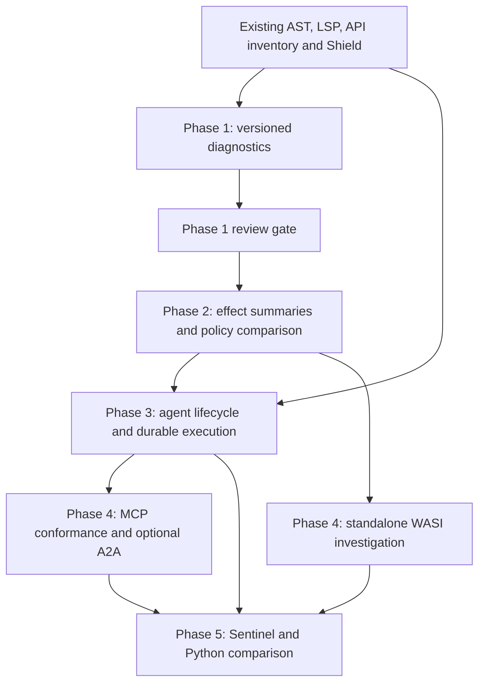

# Nexo AI-native architecture roadmap

Audit date: 2026-10-29. This roadmap extends the general-purpose language;
[the specification](especificacion-nexo.md) remains authoritative and
[decisions](decisions.md) record implementation choices. Roadmap phases below
are independent of the historical language phases and Shield phases.
Phase 1 was committed and pushed as `d71ffca`; the user subsequently authorized
Phase 2. Phase 2 is implemented as a bounded conservative analysis with configured
ceilings and explicit unknowns; [the effect contract](effects.md) documents its
coverage and [the completion record](ai-native-phase2-completion.md) its validation.
Phase 3 is complete within the documented boundaries: [typed agent boundaries and inherited control](agent-lifecycle.md),
[token budgets](agent-token-budgets.md), [confined recovery](agent-recovery.md),
monetary reservations and [opt-in tracing](agent-tracing.md). Its acceptance
record is [Phase 3 completion](ai-native-phase3-completion.md). Phases 4–5 remain
future work.

## Current implementation inventory

This inventory is based on code and tests, rather than treating every example
in the specification or README as implemented or production-validated.

| Capability | State and concrete evidence |
| --- | --- |
| General-purpose language and native compilation | Implemented: Python AST interpreter (`nexo/interpreter.py`), Rust parsing/checking/resolution/type checking and LLVM generation (`compiler/nexoc/src/`), native runtime (`compiler/runtime/`). Existing numeric, module, concurrency and contract suites remain the compatibility baseline. |
| Provider-neutral AI, local and remote | Implemented: `nexo/stdlib/ai.py`, `compiler/runtime/src/ai.rs`; OpenAI, Anthropic, Ollama, Mistral, Gemini, Azure and Bedrock adapters, profiles, aliases, fallback and credential resolution. `tests/test_ai.py` and `test_ai_providers.py` exercise local mock services in both backends. This is protocol regression coverage, not continuous certification against live providers. |
| Typed structured output | Implemented for non-streaming `ask`: JSON parsing and type validation with repair retries. D184 adds explicit typed final agent responses without conversation replay. Typed streaming is explicitly rejected. Tool schemas have depth/type representation limits; do not infer unrestricted JSON Schema support. |
| Streaming and cancellation | Incremental streaming, transport timeouts, irreversible controls and inherited cooperative deadlines are implemented (D184/D186). Protected API admissions in tools/tasks observe closure. Terminal reads, CPU work and admitted syscalls are not forcibly interrupted; opaque child-process lifecycle remains an interoperability concern. |
| Typed tools and agents | Implemented: typed tools, `input_type` guards, locally validated final `as:` results, strict tool parameters, `max_steps`, shared `max_tokens`, approval before conversion and cancellation propagation (D184–D189). Durable inputs/result types use an explicit codec subset; this is not unrestricted JSON Schema or static authorization proof. |
| Permissions and authorization | Implemented: policies, deny precedence, strict Shield execution, module/dependency ceilings, task-context intersections and sealed operator-controlled agent/tool authorization (`nexo/authorization.py`, `security_context.py`, native `security/`, `docs/shield-dispatch.md`). These are the sole runtime authorization engine. |
| Static effects | Partial foundations: linked AST, resolved calls in Rust, policy declarations and security checks. Opt-in transitive function/module summaries and explicit unknowns now exist (D182); configured dependency/caller/tool/agent comparisons, immutable aliases and record-method summaries are implemented (D183); unresolved dynamic/deferred behavior is explicitly unknown. `security check` validates a program/policy; it does not prove that every runtime operation is allowed. |
| Budgets | D185 coordinates legacy CSV budgets within the process. D187 adds operator-granted encrypted monetary accounts across processes. D189 shares invocation input/output token reservations across inherited AI work and persists them before transport. Prices/usage are trusted; unknown holds survive restart. Provider invoices and opaque external clients are not globally bounded. |
| Durable workflow/retry | D151 generic workflow behavior is retained and remains rejected under Shield. Its checkpoint commit hooks are shared with a confined, explicitly granted agent protocol (D187). Sources, execution authority, input, target and accounting state are validated; remaining calls resume with fresh approval, while uncertain dispatch/terminal failure refuses replay. No exactly-once external-effect claim is made. |
| Audit and tracing | Existing Shield decision events remain. D188 adds an explicit stderr-only OTLP JSON agent profile, pinned mapping, closed schema and redaction tests. No exporter runs by default; no payloads/application identifiers are exported. This is not an audit of every external integration. |
| MCP | Both `nexo mcp` developer-tool server (`nexo/mcp.py`, `compiler/nexoc/src/mcp.rs`) and agent MCP client support exist. Server advertises a protocol version; local transport/tool regressions exist (`tests/test_mcp.py`, `test_ai.py`). Current published-spec conformance, lifecycle, cancellation and optional transports need a separate compatibility audit. |
| A2A | No dedicated implementation identified. Requires a justified use case and security mapping before an optional adapter is proposed. |
| Native isolation and WASI | LLVM native compilation retained. Optional Shield Linux workers use actual kernel mechanisms and fail closed; Docker validation is separate. `build --target web` already has a wasm32-wasi compilation path and a constrained browser runtime (`compiler/scripts/web_*`, D175), not a complete standalone WASI deployment backend for the standard library. |
| Developer experience | Implemented formatter, lint/fix, LSP and VS Code extension; exact API inventory via `docs --for-ai` and `nexo/stdlib/api.json` (D130), test suggestion, coverage, intent checks and MCP tools. Phase 1 adds versioned `check --json` from the existing LSP error representation (D181). |
| Validation and reproducibility | `tests/unit`, conformance examples, shared two-backend tests, compiler differential/fuzz scripts, Rust lockfile and build/SBOM reproducibility regressions. `.github/workflows/security.yml`, `fuzz.yml`, `vscode-extension.yml` cover distinct layers. Python's dependency range and external system toolchains are not a fully pinned hermetic build. |
| Reference applications | `examples/log_filter.nexo`, data pipelines, `shop_api`, `deploy` and `events` provide starting points. No Nexo Sentinel application or controlled Python comparison identified. |

Reviewed inputs include README.md, specification sections 8/9/10/14/18/24–27,
decisions through D180, guarantees.md, shield.md, shield-isolation.md, compiler
front ends/runtime/scripts, Python front end/runtime/stdlib, tests, examples
and all three workflow definitions. [Measured guarantees](guarantees.md)
already distinguish test evidence, unmet performance goals and external audit
needs; this roadmap does not upgrade those claims.

## Technical gaps and proposed architecture

Keep syntax and the two execution implementations. Build shared contracts
rather than a Python wrapper or a second AI framework. Add analysis on the
existing AST/linked-module representations and keep the Rust LLVM path as the
native implementation. Extend existing `nexo.ai`, policies and Shield APIs.

1. **Diagnostic contract:** shared LSP coordinates, catalog codes and edits;
   explicit versioned envelope with a checked-in schema. CLI front ends remain
   responsible for their current checks. Future effect findings use this same
   contract, rather than embedding JSON in human diagnostic strings.
2. **Effect summaries:** per-function finite sets of operations and target
   information, plus explicit unknown effects. Compute a fixed point over call
   graph strongly connected components. Resolve module-qualified operations
   using canonical builtin identities, not identifier spelling. Represent
   known literal paths/hosts separately from dynamic target expressions.
3. **Policy comparison:** map summaries to existing policy vocabulary
   (`read`, `write`, `net`, `env`, native/process and existing connector scopes).
   AI/database activity must map to actual operations (e.g. network, credentials,
   database paths), with semantic labels for reporting. Do not invent runtime
   permissions merely from a new analysis label. Reuse deny/intersection rules;
   summaries are evidence, never authority.
4. **Agent lifecycle:** extend existing typed tools/agent dispatch with explicit
   input/result validation, cancellation propagation, budget reservation and
   persisted state transitions built on D151 workflows. Existing strict-execution
   persistence rejection remains until confined storage is implemented. Approval is operator-controlled and bound to
   the exact action/arguments, identity and workflow state. Record pending tool
   execution before dispatch and reconcile results on recovery. Require
   idempotency support or renewed human handling for uncertain external effects.
5. **Optional adapters:** MCP lifecycle/conformance first; A2A only for a concrete
   cross-agent use case. Use adapter boundaries around the existing dispatcher.
   Audit current published specifications at implementation time, pin tested
   versions and add local conformance fixtures before making compatibility claims.
6. **Execution targets:** investigate standalone WASI as an additional codegen/
   runtime target using the existing web path. Inventory unsupported APIs and
   map WASI host imports/preopens to Shield requirements. Compare enforced host
   restrictions with Linux worker guarantees; reject unsupported guarantees.

## Dependency graph

MCP/WASI investigations can be evaluated separately after the review gate;
protocol support must not force new dependencies into the core compiler.

## Security invariants

- Model output, diagnostic fixes and inferred effects cannot grant capabilities.
  Only existing explicit policy/operator authorization grants authority.
- Deny precedence and intersection of caller, module, task and tool ceilings
  remain intact. Unknown effects cannot be interpreted as pure or allowed.
- Runtime Shield checks remain mandatory even when static summaries pass.
  Distinguish an analysis warning from a deterministic authorization decision.
- API permissions do not imply OS confinement. Request explicit worker/container
  enforcement and validate it on supported hosts; unsupported profiles fail closed.
- Never omit unproven contracts for security-sensitive execution. No automatic
  execution of generated code during diagnostics; intent/model calls stay opt-in.
- Preserve secret redaction and exclude credentials from telemetry/checkpoints.
  Diagnostic text may contain user-authored names/literals: remote disclosure
  requires explicit authorization. This slice adds no telemetry or network access.
- Approval must not be forgeable by a model or replayable for changed arguments.
  Durable recovery must not silently repeat a sensitive external effect.

## Backward compatibility

Human CLI output, existing exit statuses, grammar and existing APIs are preserved.
JSON mode is opt-in; its catalog codes and UTF-16 ranges reuse LSP conventions.
`docs --for-ai` stays the API source of truth. Existing deliberate static coverage
differences (D67/D68) remain explicit; matching JSON shape does not imply matching
acceptance of every program. New analyses begin as separately requested reports;
any future enforcement/default change requires a specification decision and
migration tests. Optional adapters and backends must not change native defaults.
No new dependency is needed for Phase 1. Future dependencies need justification,
license/supply-chain review and an explanation of why existing code is insufficient.

## Incremental phases and objective acceptance criteria

### Phase 1 — implemented vertical slice

- Both CLIs provide `check --json` with schema_version 1, success, file, code,
  severity, message, optional range and existing suggested edits/metadata.
- Stdout decodes as one document on success, source failure, I/O failure and
  option failure; default human checks retain their behavior.
- Regressions compare both backends on common checks, directory ordering,
  empty files/directories, malformed input, UTF-16 positions, fixes and imports.
- Documentation specifies schema evolution, consumer behavior, sensitive output
  handling and reuse of `docs --for-ai`. D181 records the decision.
- Run Rust/Python tests, conformance and differential checks; disclose host or
  pre-existing failures. Review this slice before implementing Phase 2.

### Phase 2 — completed conservative analysis (D182–D183)

The implementation provides `check --effects [--json]` with shared builtin
models, recursive/direct/imported-call propagation, immutable aliases and literal
targets, record-method summaries, configured root/dependency/caller/tool/agent
comparisons, captured registration contexts and explicit unknowns. Manifest
loaders and permission engines are reused without initializing runtime state.
`--require-complete` rejects unresolved analysis; metadata v2 exposes scoped
checks and mandatory approval without granting it. Unknown higher-order,
parameterized, provider and deferred effects are conservative outcomes of this
phase rather than permission grants. See [completion evidence](ai-native-phase2-completion.md).

Acceptance criteria:

- Direct, nested and mutually recursive calls converge deterministically;
  imported functions retain module identity and source locations.
- Known permitted and denied literal operations yield reproducible findings
  using Phase 1 codes/ranges. Dynamic paths, aliases, callbacks, FFI, unresolved
  imports and unmodeled builtins are explicit unknowns with reason metadata.
- A pure summary requires all reachable operations to be known pure; shadowed
  builtins cannot be mistaken for runtime APIs. Higher-order calls with no
  resolved targets are never silently dropped.
- Tests cover allowed/denied access, deny precedence and intersected module/tool
  ceilings in both backends; runtime denial remains effective regardless of
  analysis results. No summarized effect bypasses Shield.
- Run existing compatibility suites and compare summaries for shared programs;
  document any deliberate analysis-coverage differences before release.
- Benchmark linear call chains, recursive components and imported graphs at
  1k/10k/100k lines; report elapsed time/memory and cap pathological analysis
  explicitly as unknown rather than hanging or claiming a complete result.

### Phase 3 — complete: bounded AI/agent lifecycle

D184–D189 extend the existing AI runtime without new grammar or dependencies:

- Typed input guards and final results, provider-neutral adapters, strict tool
  arguments, and approval before conversion/defaults.
- Inherited cancellation/deadline admissions plus step, token and monetary
  budgets. Token and money reservations account for concurrent inherited work.
- Version 2 operator state grants, encrypted/locked/atomic checkpoints and
  durable accounting. Recovery binds execution authority as well as source,
  input and target; cached results cannot bypass narrower callers.
- D151 checkpoint hooks reused, with its generic Shield persistence guard
  retained. Uncertain provider/tool dispatch and terminal failures do not replay;
  pending approvals always need a new decision.
- Explicit opt-in OTLP JSON tracing with schema validation and payload exclusion.

Acceptance uses local mocked providers in both backends for malformed replies,
typed/privacy boundaries, refusal, timeouts/cancellation, concurrent exhaustion,
crash/restart, late child receipts, retry/step exhaustion, approval replay and
changed source/grants/caller ceilings. [The completion record](ai-native-phase3-completion.md)
contains results, artifact provenance, reproduction and host/profile limits.
No hard preemption, invoice ceiling, unrestricted durable codec, generic Shield
workflow enablement or exactly-once external effects are claimed.

### Phase 4 — optional interoperability and deployment

Audit existing MCP client/server against a pinned published version and test
initialization, errors, tool schemas, disconnects, cancellation and authorization.
Add A2A only with a documented user need and an equivalent trust-boundary audit.
Prototype standalone WASI without changing LLVM native compilation; measure
supported standard-library calls and validate denied filesystem/network access
under a real host. Document unsupported operations and fail before execution
when a requested confinement guarantee is unavailable. Reuse existing deploy
examples/infrastructure integrations instead of adding deployment authority.

### Phase 5 — Nexo Sentinel validation

Build a defensive log analyzer with explicit read policy, typed findings,
deterministic suspicious-pattern rules, optional local `ask`, audit records
and explicit approval before changes to external systems. Use fake/local model
providers for offline tests. Acceptance: fixed benign/malicious/Unicode/oversized
log corpus; deterministic findings without AI; denied paths cannot be read;
approval refusal prevents every external mutation. Compare with a Python
implementation using the same corpus, rules, provider responses and isolation
profile. AI enrichment is advisory and cannot authorize remediation.

## Benchmark and validation strategy

Use `cargo test --locked`, Python unit and shared-backend tests,
`compiler/scripts/conformance.py`, `differential.py` and existing fuzz/reproducible
build checks. The security workflow already invokes the full suites; the new
CLI tests join that suite. Run positive Linux isolation checks on a compatible
Linux host and Docker checks with a real daemon; macOS skips are not evidence
of those guarantees. Formatting uses existing Nexo formatter tests and extension
checks; there is no repository-wide Python/Rust lint configuration to invent.

For diagnostic performance, generate fixed valid and single-error corpora at
1k/10k/100k lines with a recorded seed/hash. Measure wall time, peak RSS, output
bytes and error/fix counts for human and JSON check separately in each backend,
including imports and Unicode. Record toolchain, host, build mode and median/
p95 over repeated runs; establish a baseline before setting a regression budget.
No performance improvement is claimed by this Phase 1 change.

For Sentinel compare cold/warm startup, throughput, peak RSS, deployment size,
policy-denial behavior, precision/recall against labeled deterministic findings,
and auditable approval events. Separate model latency/cost from language/runtime
cost. Keep mock responses, versions and seeds in the repository; live provider
benchmarks remain explicit, separately authorized runs. Never substitute model
agreement for deterministic correctness or authorization tests.
