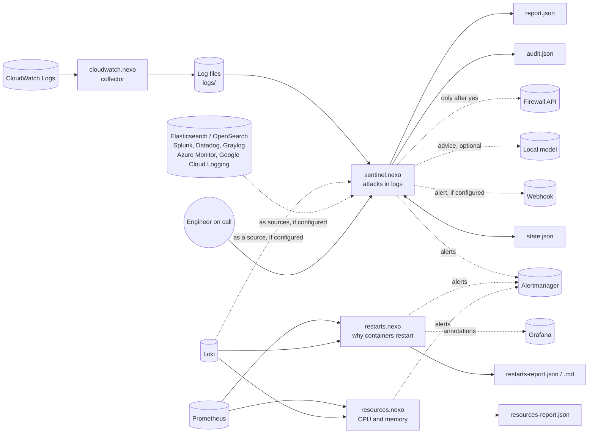
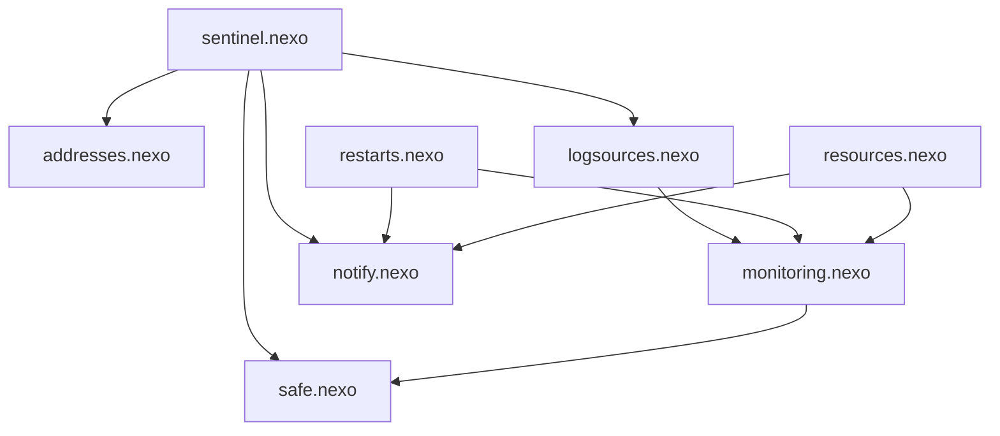
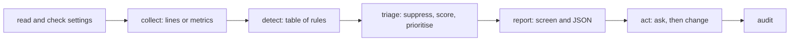

# Nexo Sentinel: architecture

Three programs that read and one decision a person takes. This page says
how they are built, what each part may touch and why.

## Context

| Program | Question it answers | Reads | Writes | Changes outside |
|---|---|---|---|---|
| `sentinel.nexo` | Who is attacking, how sure are we, who first? | `logs/`, `sentinel.json`, `state.json` | `report.json`, `audit.json`, `state.json` | the firewall, after a typed `yes`; a webhook is told, if one is set |
| `cloudwatch.nexo` | (collector) What did CloudWatch log since the last run? | CloudWatch Logs, `cloudwatch.json` | `logs/cloudwatch-*.log`, `cloudwatch-state.json` | nothing |
| `restarts.nexo` | Which containers restarted and why? | Prometheus, Loki | `restarts-report.json`, `.md` | nothing |
| `resources.nexo` | Which containers grew or are near a limit? | Prometheus, Loki | `resources-report.json` | nothing |

## Modules

- `safe.nexo`: the one place that decides what may be shown. Secrets are
  replaced by `<redacted>`, invisible and control characters by
  `<hidden>` and `<control>`, and a text is cut at 100 characters. Every
  line of a log passes through it before it reaches a screen or a report.
- `monitoring.nexo`: the queries to Prometheus and Loki, the encoding of
  a query, the check of a Kubernetes name and of a window, and the
  request headers (tenant, `Authorization` from a secret).
- `logsources.nexo`: one function, `lines_of(entry, window, limit)`,
  that gives the lines of a query to Loki, Elasticsearch or OpenSearch,
  Splunk, Datadog, Graylog, Azure Monitor or Google Cloud Logging, the
  oldest first. `sentinel.nexo` scans those lines
  with the code that scans a file, so a new system is one function here
  and no change to a rule.
- `notify.nexo`: the two places that are told, Alertmanager and Grafana.
  It builds an alert from labels and a summary; a program decides what
  is worth one. Paging tools are reached through Alertmanager, so there
  is one integration to keep instead of one for each tool.
- Each program keeps what is its own: its settings type, its table of
  rules or causes, its decisions and its report.

In `sentinel.nexo` detection has two stages. `scan_file` reads one log
and gives the findings a line shows by itself (an injection, a hidden
character) and **events**: a failed or accepted login, a 404, an object
asked for, each with when it happened in seconds. `correlate` then puts
every event of the run, and those of the last window kept in
`state.json`, in the order they happened, and counts each with the
others of its key in `count_window`. So a count does not depend on which
file or which run an event came in, and the rules that count live in one
function.

Inside each program the steps are the same, and each is a function that
can be tested alone:

Detections are data. A rule of `sentinel.nexo` is a row of `RULES` (id,
name, severity, confidence, tactic, reference, pattern, action); a cause
of `restarts.nexo` a row of `CAUSES`. Adding one that a pattern can
express is one line and one line of the corpus.

## Triage in sentinel.nexo

A finding has a **severity** (how bad, if true) and a **confidence** (is
a match the thing itself, or a suspicion). They are kept apart because
they lead to different actions:

| Finding of an address | Proposal | Priority |
|---|---|---|
| high and sure, in more than one ATT&CK tactic, or a login accepted after failures | block | P1 |
| high and sure | block (or `protected`, if in `never_block`) | P2 |
| high but a suspicion (IDOR: SEN-204, SEN-205) | review | P3 |
| medium or low only | watch | P4 |

Among equals the highest score comes first (10 for a high finding, 4 for
a medium one, 1 for a low one). Each address also carries its tactics and
the times of its first and last finding.

`suppress` in `sentinel.json` silences a rule, an address or the pair,
and must give a reason; an entry for every rule of every address is
refused. A suppressed finding is not scored and proposes nothing, but it
is listed on screen, written to `report.json` and recorded in
`audit.json`, so that what was silenced can always be answered.

## Trust boundaries

| Input | Trusted? | How it is handled |
|---|---|---|
| Lines of a log | No: whoever sends a request writes them | read as data only; shown through `safe.nexo`; never sent to the model; a line over 4096 characters is reported and not examined |
| X-Forwarded-For | Only from a trusted proxy | read from the right, skipping trusted proxies, and only when the address that connected is one; otherwise ignored, so a client cannot choose the address that is blamed |
| Names from Prometheus | No | checked against the form of a Kubernetes name before they go into a Loki query |
| Settings files | Yes, written by the operator | checked against a type; `window`, `namespace` and `suppress` are checked again before use |
| The model's answer | No | printed as advice; no code reads it |
| The person's answer | Yes | only the word `yes` approves; anything else, and the end of input, is a no |

What the programs may touch is in each `policy` block: named files, the
log folder and named hosts; shell commands are denied. The policy is
enforced by the standard library in a release build and warns in
development mode. It is not isolation by the operating system: run it as
a user that can read the logs and nothing more.

## Decisions

1. **Rules decide, the model advises.** Findings come from fixed patterns
   and counts, so the same logs give the same report, and the report can
   be tested against a labelled corpus. The model sees rule names and
   addresses only and cannot approve anything.
2. **Detect and respond are separate steps.** Nothing outside changes
   without a person typing `yes` to the exact list shown. The approval
   and every block, or failure to block, are audited. A block has an end
   (`block_ttl`) and is lifted when it comes; one that cannot be
   recorded is undone at once (`action` and `undo()`), so the firewall
   never holds a block that nobody will lift.
3. **A suspicion never blocks.** A log cannot say who owns an object, so
   IDOR findings ask for a review. Blocking on them would turn a false
   positive into an outage for a real user.
4. **One place for what is shown.** Redaction and the handling of hidden
   characters live in `safe.nexo`; a report cannot leak a token or
   rewrite a terminal because a program forgot to clean a line. The
   sources themselves are ASCII, which the tests check.
5. **An alert tells, it does not act.** The webhook gets addresses and
   rule names, the same that the model gets, and is opt-in. It is sent
   without a question because it changes nothing; the block still needs
   its `yes`.
6. **State is small and can be thrown away.** `state.json` holds a count
   and the first line of each file. Deleting it makes the next run read
   everything again; a rotated file is noticed by its first line.
7. **Read-only by default.** The two monitoring programs have no write to
   any system. Only `sentinel.nexo` has one, and its policy names the host.
8. **Fail closed, degrade open.** Wrong settings stop a program before
   any request. A missing optional metric, or Loki being down, is said
   and the rest of the report stands.
9. **Reports are an interface.** Each JSON report is the full data of
   what was printed; `report.json` carries `tool` and `schema` so that a
   reader can tell a change of shape.
10. **A second implementation as an oracle.** `compare/sentinel.py` is the
   same program in Python; the tests require the same output and report,
   which catches a rule that means something else than intended.

11. **A collector where a source needs more than HTTP.** CloudWatch needs
    signed requests, and so Python's HMAC and the keys of AWS. Putting
    that in `sentinel.nexo` would give the program that reads untrusted
    logs and can change the firewall both Python and cloud keys.
    `cloudwatch.nexo` has them instead, can only write under `logs/`,
    and hands over a file.

12. **Count by time, not by file.** A limit such as "5 failed logins"
    means nothing without a time. Counting in a window of time, across
    logs and runs, is what lets an attack spread over files or runs be
    found, and lets the same limit mean the same thing on a busy host and
    a quiet one. Each rule reports once for each window so that a long
    attack does not fill the report with copies.
## Operating it

- **P1**: look now. Read the address's findings in order, confirm with the
  application's own records, then answer the block question.
- **P2**: block in this run unless the address is known; if it is
  `protected`, it cannot be blocked from here: escalate to its owner.
- **P3**: open the lines named, check who owns the objects, and either
  fix the endpoint or add a `suppress` entry with the reason.
- **P4**: no action; they are context for the next run.
- A restart that is `critical`, or a container with RES-101, is a page;
  the rest is for working hours.

## Limits

- Counts are kept between runs only with `incremental`. Without it, a
  run counts across all its logs, but an attack split between two runs
  can stay under a limit.
- A syslog time has no zone and is taken as UTC; a host that logs in
  local time shifts its events by its offset from UTC.
- Addresses are joined up only for failed logins of one user (SEN-206);
  other attacks spread over many addresses are not.
- `restarts.nexo` and `resources.nexo` have run against stand-ins that
  answer the HTTP APIs of Prometheus and Loki, not against real ones.
- An alert is resolved by the run after the one that last saw its cause.
  Nothing schedules a run: a program that stops running leaves its
  alerts to end by themselves an hour after they were last sent.
- The lines `sentinel.nexo` reads from a log source are a window of at
  most `source_lines` (1000) for each query, without paging: a busy
  window is cut to its newest lines, and lines older than the newest
  1000 are never seen. With `incremental`, a source is followed by the
  time of its newest line, so a run that starts after a long stop only
  sees the newest `source_window`.
- Alertmanager, Grafana, Loki, Elasticsearch, Splunk and Datadog have
  been reached only as stand-ins that answer their HTTP APIs in the
  tests, written from each one's documented API.
- Graylog and CloudWatch Logs have likewise been reached only as
  stand-ins. The one for CloudWatch checks every signature with its own
  implementation, and the signing key is tested against the example of
  the AWS documentation. It has not read a real log group.
- Azure Monitor and Google Cloud Logging are read with a token the
  operator gives, which lasts about an hour; Sentinel does not get or
  renew one, because that needs a client secret in the body of a request
  and a secret of Nexo goes only in a header. Both have been reached only
  as stand-ins.
- A lock left by a run that stopped holds for an hour, and a run that
  waits more than an hour for its questions can have its lock taken
  over.
- `audit.json` is a plain file; it is not signed or protected from
  whoever can write to the folder.
