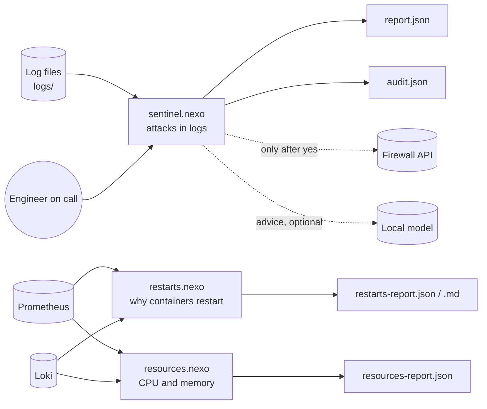
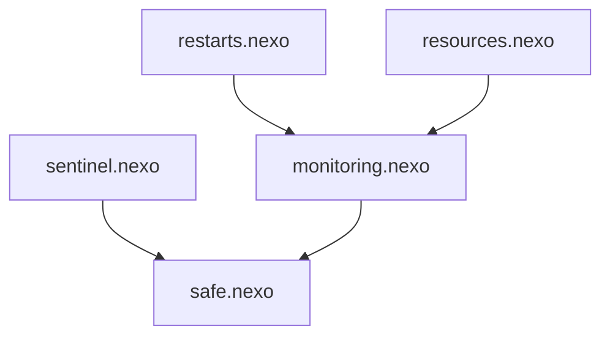
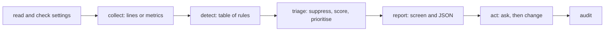

# Nexo Sentinel: architecture

Three programs that read and one decision a person takes. This page says
how they are built, what each part may touch and why.

## Context

| Program | Question it answers | Reads | Writes | Changes outside |
|---|---|---|---|---|
| `sentinel.nexo` | Who is attacking, how sure are we, who first? | `logs/`, `sentinel.json` | `report.json`, `audit.json` | the firewall, after a typed `yes` |
| `restarts.nexo` | Which containers restarted and why? | Prometheus, Loki | `restarts-report.json`, `.md` | nothing |
| `resources.nexo` | Which containers grew or are near a limit? | Prometheus, Loki | `resources-report.json` | nothing |

## Modules

- `safe.nexo`: the one place that decides what may be shown. Secrets are
  replaced by `<redacted>`, invisible and control characters by
  `<hidden>` and `<control>`, and a text is cut at 100 characters. Every
  line of a log passes through it before it reaches a screen or a report.
- `monitoring.nexo`: the queries to Prometheus and Loki, the encoding of
  a query, the check of a Kubernetes name and of a window, and the
  request headers (tenant, `Authorization` from a secret).
- Each program keeps what is its own: its settings type, its table of
  rules or causes, its decisions and its report.

Inside each program the steps are the same, and each is a function that
can be tested alone:

Detections are data. A rule of `sentinel.nexo` is a row of `RULES` (id,
name, severity, confidence, tactic, reference, pattern, action); a cause
of `restarts.nexo` a row of `CAUSES`. Adding one that a pattern can
express is one line and one line of the corpus.

## Triage in sentinel.nexo

A finding has a **severity** (how bad, if true) and a **confidence** (is
a match the thing itself, or a suspicion). They are kept apart because
they lead to different actions:

| Finding of an address | Proposal | Priority |
|---|---|---|
| high and sure, in more than one ATT&CK tactic, or a login accepted after failures | block | P1 |
| high and sure | block (or `protected`, if in `never_block`) | P2 |
| high but a suspicion (IDOR: SEN-204, SEN-205) | review | P3 |
| medium or low only | watch | P4 |

Among equals the highest score comes first (10 for a high finding, 4 for
a medium one, 1 for a low one). Each address also carries its tactics and
the times of its first and last finding.

`suppress` in `sentinel.json` silences a rule, an address or the pair,
and must give a reason; an entry for every rule of every address is
refused. A suppressed finding is not scored and proposes nothing, but it
is listed on screen, written to `report.json` and recorded in
`audit.json`, so that what was silenced can always be answered.

## Trust boundaries

| Input | Trusted? | How it is handled |
|---|---|---|
| Lines of a log | No: whoever sends a request writes them | read as data only; shown through `safe.nexo`; never sent to the model; a line over 4096 characters is reported and not examined |
| Names from Prometheus | No | checked against the form of a Kubernetes name before they go into a Loki query |
| Settings files | Yes, written by the operator | checked against a type; `window`, `namespace` and `suppress` are checked again before use |
| The model's answer | No | printed as advice; no code reads it |
| The person's answer | Yes | only the word `yes` approves; anything else, and the end of input, is a no |

What the programs may touch is in each `policy` block: named files, the
log folder and named hosts; shell commands are denied. The policy is
enforced by the standard library in a release build and warns in
development mode. It is not isolation by the operating system: run it as
a user that can read the logs and nothing more.

## Decisions

1. **Rules decide, the model advises.** Findings come from fixed patterns
   and counts, so the same logs give the same report, and the report can
   be tested against a labelled corpus. The model sees rule names and
   addresses only and cannot approve anything.
2. **Detect and respond are separate steps.** Nothing outside changes
   without a person typing `yes` to the exact list shown. The approval
   and every block, or failure to block, are audited.
3. **A suspicion never blocks.** A log cannot say who owns an object, so
   IDOR findings ask for a review. Blocking on them would turn a false
   positive into an outage for a real user.
4. **One place for what is shown.** Redaction and the handling of hidden
   characters live in `safe.nexo`; a report cannot leak a token or
   rewrite a terminal because a program forgot to clean a line. The
   sources themselves are ASCII, which the tests check.
5. **Read-only by default.** The two monitoring programs have no write to
   any system. Only `sentinel.nexo` has one, and its policy names the host.
6. **Fail closed, degrade open.** Wrong settings stop a program before
   any request. A missing optional metric, or Loki being down, is said
   and the rest of the report stands.
7. **Reports are an interface.** Each JSON report is the full data of
   what was printed; `report.json` carries `tool` and `schema` so that a
   reader can tell a change of shape.
8. **A second implementation as an oracle.** `compare/sentinel.py` is the
   same program in Python; the tests require the same output and report,
   which catches a rule that means something else than intended.

## Operating it

- **P1**: look now. Read the address's findings in order, confirm with the
  application's own records, then answer the block question.
- **P2**: block in this run unless the address is known; if it is
  `protected`, it cannot be blocked from here: escalate to its owner.
- **P3**: open the lines named, check who owns the objects, and either
  fix the endpoint or add a `suppress` entry with the reason.
- **P4**: no action; they are context for the next run.
- A restart that is `critical`, or a container with RES-101, is a page;
  the rest is for working hours.

## Limits

- A run reads whole files; there is no position kept between runs, so a
  schedule re-reads and re-reports what it saw before.
- Counts (failed logins, 404s, ids) are for each file, not for a window
  of time, and an attacker who spreads requests over addresses is not
  joined up.
- IDs that are not numbers (UUIDs) are not followed for IDOR.
- `restarts.nexo` and `resources.nexo` have run against stand-ins that
  answer the HTTP APIs of Prometheus and Loki, not against real ones.
- There is no alert sent anywhere: a person runs a program and reads it.
- `audit.json` is a plain file; it is not signed or protected from
  whoever can write to the folder.
